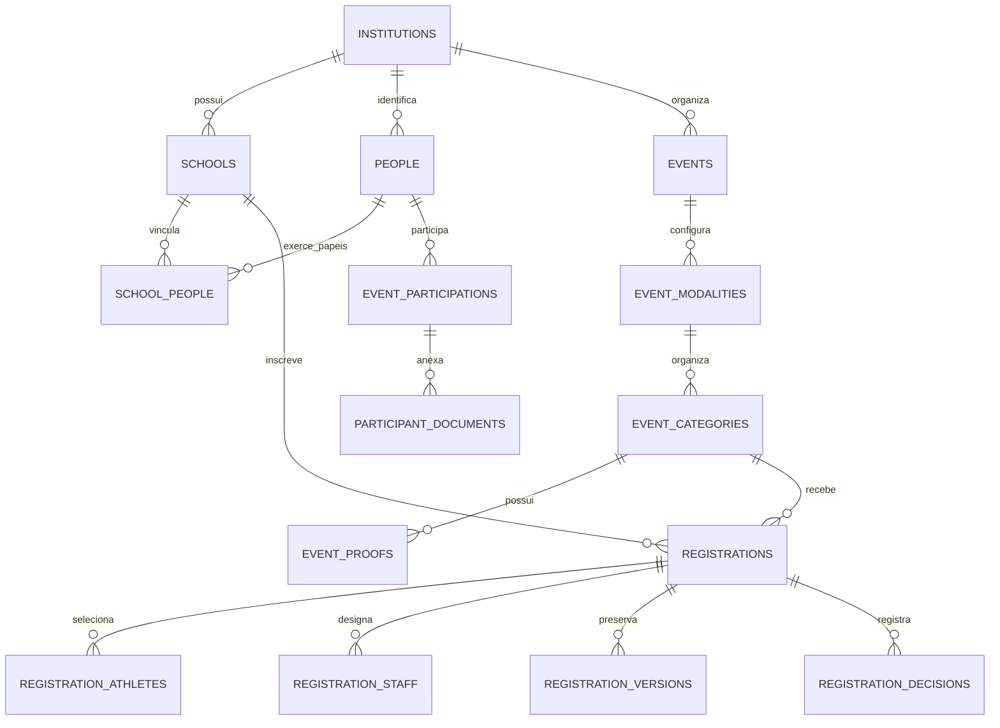

# Banco SIEP

Projeto: `siep` (`oshzcmmbhxvmchjgxztp`). Treze migrações versionadas, aplicadas e verificadas: a base inicial e doze incrementos para os fluxos previstos em CONTINUIDADE.md. O portal conectado usa a navegação completa, com pessoas, participações, arquivos privados, inscrições/análise, relatórios, notificações e área da escola. A demonstração anterior continua separada, sem importação automática.

## Operação e histórico

Python 3, biblioteca padrão, usando a credencial segura `SUPABASE_ACCESS_TOKEN` já preparada para `api.supabase.com`. Nunca colocar essa credencial em `VITE_`, no frontend ou na Vercel.

```sh
# Executa pendentes + todos os testes SQL e desfaz a transação.
python scripts/supabase_migrate.py --project-ref oshzcmmbhxvmchjgxztp
# Executa pendentes + testes e confirma somente se tudo passar.
python scripts/supabase_migrate.py --project-ref oshzcmmbhxvmchjgxztp --apply
# PostgreSQL 17 descartável, quatro suítes SQL e concorrência com conexões reais.
python scripts/test_database.py
```

O teste local requer Docker no socket local. Usa a imagem oficial `postgres:17`, não publica portas, não usa credenciais reais e remove o container ao terminar. `supabase/local/bootstrap.sql` contém contratos mínimos de Auth/Storage só para esse teste. **Nunca executar esse bootstrap no Supabase.** As mesmas suítes SQL são validadas no Supabase real com rollback; os stubs locais não simulam login HTTP nem upload de bytes.

Histórico próprio em `siep_migrations.applied`, com versão, SHA-256 e data. O executor verifica checksums, recusa checkout sem migrações já registradas, obtém trava transacional e revalida cada pendência sob essa trava. Migrações aplicadas são imutáveis. Criar novo arquivo para evoluções. Não usar reset, DROP ou TRUNCATE para resolver divergências.

Esse histórico não é o do Supabase CLI. Não executar os mesmos arquivos diretamente pelo CLI sem reconciliar os históricos. Em falha de rede/timeout, consultar o histórico numa conexão nova antes de repetir; não presumir o resultado do commit.

## Migrações

| Versão | Entrega |
| --- | --- |
| `20261111233000` | Instituições, escolas, identidade, eventos, configuração, participações e documentos privados |
| `20261112000100` | Inscrições, integrantes, vagas, versões, decisões, solicitações, transferências e notificações |
| `20261112000200` | Validação das oito regras, elegibilidade, parâmetros e integridade das vagas |
| `20261112000300` | RLS por conta/instituição/escola e RPCs de cadastro, envio, análise e vínculos |
| `20261112000400` | Storage, auditoria, duplicação de eventos, transferências e notificações |
| `20261112000500` | Elegíveis/prévia/recibo, capacidade, proteção do último admin e outbox |
| `20261112000600` | Evento ativo, identidade com vários papéis, arquivamento e mapeamento legado |
| `20261112000700` | Limite de escola da comissão técnica também nos rascunhos/snapshots |
| `20261112130000` | Configuração atômica por seção e exigências desativadas preservadas |
| `20261112131000` | Reserva privada do primeiro administrador, ativada apenas após confirmar e-mail |
| `20261112132000` | Duplicação preserva exigências de documentos desativadas |
| `20261112140000` | Pessoas/participações conectadas, versão/arquivo por perfil e remoção lógica de documento |
| `20261112141000` | Elenco de revezamento com preservação dos limites explícitos de categorias de equipe |

Os nomes são identificadores de ordenação UTC, não datas de inscrição.

## Modelo entregue: 29 tabelas públicas

| Grupo | Tabelas |
| --- | --- |
| Clientes e contas | `institutions`, `institution_memberships` |
| Escolas e pessoas | `schools`, `people`, `school_people`, `school_link_requests`, `membership_decisions` |
| Configuração por edição | `events`, `event_modalities`, `event_categories`, `event_proofs`, `event_rules`, `event_fields`, `document_requirements`, `event_staff_roles`, `event_configuration_versions` |
| Cadastro e documentos | `event_participations`, `participation_categories`, `participant_documents` |
| Inscrições e análise | `registrations`, `registration_athletes`, `registration_staff`, `registration_versions`, `registration_decisions` |
| Operação e histórico | `school_event_contexts`, `athlete_transfer_requests`, `notifications`, `audit_log`, `legacy_id_mappings` |

Além delas, a fila de e-mail fica em `siep_private.notification_outbox` e o histórico de migrações em `siep_migrations.applied`.



Chaves estrangeiras compostas impõem instituição, edição e escola nas relações. CPF normalizado/válido é único por cliente; uma identidade pode ter vários papéis. Não há cascatas destrutivas nem dados de demonstração persistidos no banco.

## Regras e concorrência

- Os quatro dados pessoais são obrigatórios também no servidor. Cadastros antigos incompletos do navegador continuam preservados; não foram importados automaticamente.
- Ano de nascimento usa os extremos inclusivos configurados, independentemente do nome da categoria. Sexo da pessoa é comparado com categoria/prova quando definido.
- As oito regras do catálogo têm parâmetros tipados: `modalities`, `athleteCategories`, `proofs`, `proofEntries`, `roster`, `schoolEntries`, `age`, `staffLimits`. `null`/ausência não limita; zero é um limite real. Idade exige data de referência válida.
- Regras gerais e específicas se acumulam, consideram os outros rascunhos da mesma edição e excluem canceladas/indeferidas. Revezamento usa a classificação da modalidade de origem.
- Rascunho pode guardar pendências esportivas; envio e aprovação reavaliam configuração, vínculos, dados, documentos, sexo, nascimento, comissão e regras atuais. Concluir cadastro não cria inscrição.
- Uma inscrição representa uma categoria e, quando houver, uma prova. Provas exigem capacidade configurada para envio. As posições positivas são limitadas a N por escola/prova, com índices únicos para posição e atleta. O mesmo atleta não pode ocupar duas posições na mesma prova, mesmo que uma regra antiga de repetição tenha máximo maior que um.
- Seleções em rascunhos ativos impedem duplicidade técnica entre seletores; não significam aprovação. Mínimo do elenco/revezamento é uma validação separada da capacidade máxima.
- Alterações de inscrições e configurações usam a mesma trava da edição. Reduzir capacidade abaixo de uma posição já selecionada é recusado. Revisão esperada impede duas edições de sobrescreverem a mesma inscrição.
- A consulta de elegíveis aplica requisitos e regras por atleta; a prévia avalia o conjunto completo, incluindo mínimos e comissão, sem gravar. Envio e aprovação sempre revalidam.

## Autorização

Todas as 29 tabelas públicas têm RLS. `anon` não lê dados nem executa RPCs do SIEP. `authenticated` lê somente pelo escopo permitido; operações sensíveis exigem RPCs e não têm INSERT/UPDATE/DELETE direto.

- Administradores e gestores aprovados operam somente na instituição vinculada. Administradores gerenciam os papéis administrativos; o último admin aprovado não pode ser removido acidentalmente.
- Responsáveis aprovados leem e operam sua escola. Escolher uma escola ou pedir vínculo não concede acesso. Solicitantes veem apenas sua solicitação/situação; a secretaria recebe a identidade declarada para conferência.
- O diretório autenticado de autocadastro devolve somente ID, nome e INEP das escolas ativas da instituição escolhida; não é uma consulta pública de pessoas.
- Aprovação de responsáveis é da secretaria, com justificativa e histórico. O primeiro administrador é provisionado administrativamente após existir uma conta real no Auth; não há endpoint público para virar administrador.
- Todas as funções `SECURITY DEFINER` fixam `search_path` e revogam execução pública. Predicados privados recebem apenas a permissão necessária para RLS. Auditoria e históricos são protegidos contra alteração.

Login/recuperação e vínculo de contas já estão integrados nas primeiras telas. O IDJUV foi provisionado administrativamente, com o endereço do primeiro admin reservado em tabela privada. Nenhuma senha foi criada; a conta será criada pelo titular e ativada após confirmação do e-mail.

## Arquivos e histórico

Bucket `siep-documents` privado: PDF/PNG/JPEG, até 5 MB e limite menor por exigência. Metadados têm caminho por instituição/edição/cadastro, MIME, tamanho, versões e referência à exigência. Documento comum é anexado uma vez por cadastro/edição; exigência por categoria também é suportada no banco.

Fluxo: preparar metadados → enviar pelo Storage com a conta autorizada → finalizar após verificar existência, MIME e tamanho do objeto → revalidar/concluir cadastro. Só então o documento pode satisfazer uma exigência. As políticas impedem upload fora do escopo e não concedem sobrescrita/exclusão dos objetos. Trocas geram novo caminho e preservam a versão anterior. Cadastro em inscrição enviada/aprovada exige correção antes de mudar documentos.

Testes SQL verificam autorização e metadados no Storage real com fixtures desfeitas; não foram enviados bytes de arquivos. Inspeção do conteúdo binário/antivírus e o cliente de upload pertencem à futura integração, não são serviços executados por esta migração.

Versões de inscrições preservam a identidade, escola, categoria/prova, documentos e configuração usadas naquele momento. Decisões têm autor, justificativa, revisão e prazo de correção. `audit_log` registra alterações administrativas, incluindo dados pessoais; acesso restrito ao administrador da instituição.

## Outros fluxos preparados

- Duplicação gera novos IDs para modalidades, categorias, provas, regras, exigências, campos e funções; preserva opções desativadas e remapeia referências. Começa em rascunho, sem inscrições/pessoas/arquivos/datas antigas. Anos e datas de referência continuam exigindo revisão na nova edição.
- Transferência solicita análise, impede mudança com participação não arquivada em edição em curso e não reescreve a escola das inscrições históricas.
- Evento ativo é persistido por escola. Arquivar cadastro não apaga a pessoa nem permite abandonar inscrições ativas sem revisão.
- Notificações de decisões são registradas com deduplicação e outbox transacional. A fila tem reserva concorrente, token e tentativas limitadas. Nenhum e-mail de notificação foi enviado pelo agente; um worker externo ainda precisa consumir a fila.
- Mapeamentos de IDs legados têm origem/tipo e validam alvo da mesma instituição. Exportação/importação dos navegadores requer cliente específico e validação de conflitos; não foi executada importação.

## Validação e limites da entrega

Seis suítes SQL (`foundation`, `operations`, `security`, `workflow`, `connected_configuration`, `full_portal`) cobrem RLS com papéis reais, anon, escopo por escola/cliente, solicitação/aprovação de vínculo, parâmetros das oito regras, exemplo esportivo aprovado, faixa/sexo, documentos, envio/correção/aprovação, duplicação, transferência, histórico e outbox. Fixtures são sempre revertidas.

Reexecução após aplicar confirmou zero migrações pendentes, 29 tabelas protegidas, contagens anteriores e bucket preservados e nenhum fixture persistido.

Três testes com conexões PostgreSQL simultâneas cobrem disputa da mesma vaga, disputa da mesma pessoa em vagas diferentes e edição com revisão desatualizada. Esses testes usam somente o PostgreSQL descartável local.

As telas existentes estão integradas, inclusive pessoas, participações, arquivos, inscrições, análise, relatórios e notificações internas. Os dados de localStorage/IndexedDB não estão disponíveis no executor e continuam nos navegadores. Worker de e-mail e importação explícita ainda precisam ser ligados a estes contratos sem refazer o modelo principal. Competições e inscrições públicas continuam fora do escopo, conforme decisão anterior.

Contratos e exemplos: [API.md](API.md).

## Perfis e arquivos no portal completo

`school_people.archived` arquiva somente o vínculo/papel naquela escola; `people.archived` continua como estado administrativo da identidade. `version`/`updated_at` do vínculo e timestamp da identidade permitem recusar edição desatualizada. `siep_save_connected_person` grava pessoa, perfil e rascunho da participação em uma transação, sem transformar isso em inscrição. A escola existente não pode ser trocada por edição do vínculo; transferência continua exigindo análise.

Uploads seguem o protocolo de preparação/Storage/finalização já previsto. A gravação do arquivo não pode participar da mesma transação PostgreSQL; falha parcial mantém o cadastro em rascunho e o cliente informa isso explicitamente. `siep_remove_document` remove logicamente a referência atual, preservando o objeto/versões para histórico.

Um revezamento em categoria individual usa seu mínimo próprio em vez do elenco unitário da categoria individual. Categorias de equipe e regras explícitas de elenco continuam aplicando seus limites cumulativamente. Testes cobrem um revezamento real de quatro pessoas e a rejeição quando um limite explícito de equipe é excedido.
